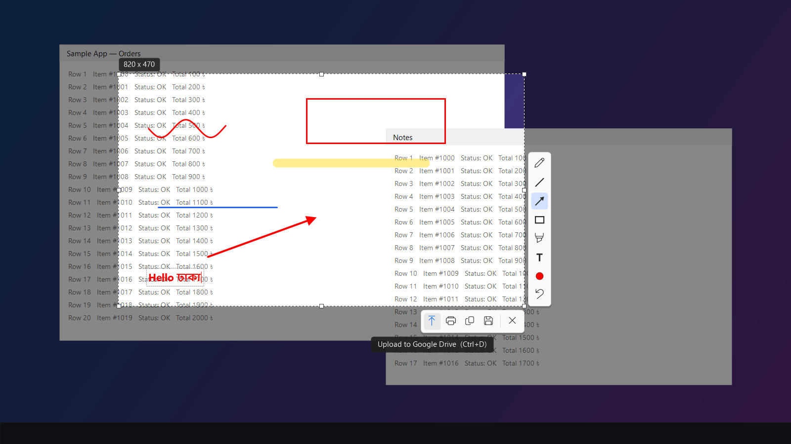
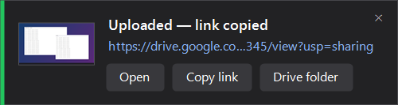

# DriveShot

A Lightshot-style screenshot tool for Windows that uploads straight to **Google Drive**.
Press <kbd>PrtSc</kbd>, select an area, annotate it, and click **Upload** — the image lands in a
dated sub-folder (`yyyy-MM-dd`) of your Drive folder and the share link is copied to your clipboard.

## Install

**[Download DriveShot-Setup.exe](https://github.com/itsrahat62/DriveShot/releases/latest/download/DriveShot-Setup.exe)**
— Windows 10/11 (64-bit). No admin rights and no .NET install needed.

1. Run the setup. Windows SmartScreen may warn because the installer isn't code-signed: click *More info → Run anyway*.
2. Keep **“Start DriveShot automatically when Windows starts”** ticked if you want PrtSc to work as soon as your PC is on.
3. When setup finishes, DriveShot starts in the tray and opens **Connect Google Drive**.
   Follow the five steps there (about 3 minutes, once). Full guide: **[Connect DriveShot to your Google Drive](docs/connect-google-drive.md)**.

Uninstall from *Settings → Apps → Installed apps → DriveShot*.

Prefer no installer? Use the portable
[DriveShot.exe](https://github.com/itsrahat62/DriveShot/releases/latest/download/DriveShot.exe);
it asks whether to start with Windows the first time you run it.





## Features

- **Area capture** across all monitors (per-monitor DPI aware), with resize handles, arrow-key nudging and a live size label.
- **Annotations:** pen, line, arrow, rectangle, marker, text (Bangla works too), colour palette, line width with the mouse wheel, undo.
  Hold <kbd>Shift</kbd> for straight lines and squares.
- **Actions:** upload to Drive, copy, save (PNG/JPG/BMP), print.
- **Upload popup** with a thumbnail, the link, and *Open / Copy link / Drive folder* buttons. Failed uploads can be retried.
- A local copy of every upload is kept in `Pictures\DriveShot\yyyy-MM-dd\`.
- Tray icon with recent uploads, today's Drive folder, settings, and *Start with Windows*.

## Keyboard shortcuts

| Keys | Action |
| --- | --- |
| <kbd>PrtSc</kbd> | Select an area |
| <kbd>Ctrl</kbd>+<kbd>PrtSc</kbd> | Upload the full screen immediately |
| <kbd>Shift</kbd>+<kbd>PrtSc</kbd> | Save the full screen |
| <kbd>Ctrl</kbd>+<kbd>D</kbd> / <kbd>C</kbd> / <kbd>S</kbd> / <kbd>P</kbd> | Upload / copy / save / print the selection |
| <kbd>Ctrl</kbd>+<kbd>Z</kbd> | Undo |
| <kbd>Ctrl</kbd>+<kbd>A</kbd> | Select the whole monitor |
| <kbd>P</kbd> <kbd>L</kbd> <kbd>A</kbd> <kbd>R</kbd> <kbd>M</kbd> <kbd>T</kbd> | Pen, line, arrow, rectangle, marker, text |
| Mouse wheel | Line width / text size |
| Right-click | Clear the selection (again to close) |
| <kbd>Esc</kbd> | Close |

If Lightshot is running it owns <kbd>PrtSc</kbd>; DriveShot offers to close it. Turn off Lightshot in
*Task Manager → Startup apps* so the two don't race at sign-in.

## Connecting Google Drive

Each person connects their **own** Drive. DriveShot uploads through a small Google Apps Script
([`apps-script/Code.gs`](apps-script/Code.gs)) that runs in their Google account. It's fast (a couple of
seconds), has no rate limits, and needs nothing else installed.

Use **tray icon → Connect Google Drive…**: it fills the script in for you and lists every click.
To set it up by hand, change only `FOLDER_ID` and `SECRET` at the top of `Code.gs`.
Both ways, plus troubleshooting, are in **[docs/connect-google-drive.md](docs/connect-google-drive.md)**.

### Alternative: rclone

Uses an existing [rclone](https://rclone.org) Google Drive remote. Leave the Apps Script URL empty and fill in
the remote name and the Drive folder link. The signed-in account needs **Editor** access to the folder.
rclone's shared Google client is heavily rate-limited, so uploads can take 10–20 seconds;
[using your own client ID](https://rclone.org/drive/#making-your-own-client-id) fixes that.

## Build

Requires the .NET 9 SDK on Windows.

```powershell
# Self-contained single exe (what the release ships)
dotnet publish DriveShot.csproj -c Release -r win-x64 --self-contained true -p:PublishSingleFile=true `
  -p:EnableCompressionInSingleFile=true -p:IncludeNativeLibrariesForSelfExtract=true -p:DebugType=None -o release

# Installer (needs Inno Setup 6) -> release\DriveShot-Setup.exe
& "$env:LOCALAPPDATA\Programs\Inno Setup 6\ISCC.exe" installer\DriveShot.iss
```

Settings, upload history and the log live in `%APPDATA%\DriveShot\` (override with the `DRIVESHOT_DATA` environment variable).

Developer checks: `DriveShot.exe --render-test <folder>` renders the UI to PNGs, and
`DriveShot.exe --upload-test <image> <result.txt> [apps-script-url | folder-id]` runs one real upload.
