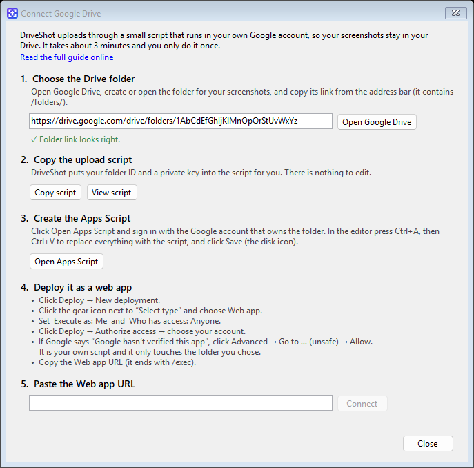

# Connect DriveShot to your Google Drive

DriveShot uploads through a small **Google Apps Script** that runs in *your own* Google account.
Your screenshots go straight into a Drive folder you choose, inside a dated sub-folder
(`2026-10-19/Screenshot_2026-10-19_11-45-12.png`). Nobody else's server is involved.

It takes about 3 minutes and you only do it once.



## The easy way: the Connect window

The window opens by itself the first time you start DriveShot. You can open it again any time from
**tray icon → Connect Google Drive…**

1. **Choose the Drive folder.**
   Click **Open Google Drive**, create or open the folder you want your screenshots in, and copy the link
   from the browser's address bar. It looks like `https://drive.google.com/drive/folders/1AbC…`.
   Paste it into the box. You should see *✓ Folder link looks right*.
2. **Copy the upload script.** Click **Copy script**.
   DriveShot fills in your folder ID and a private key for you, so there is nothing to edit.
   (Click **View script** if you want to read it first.)
3. **Create the Apps Script.** Click **Open Apps Script** and sign in with the **same Google account that owns the folder**.
   In the editor press <kbd>Ctrl</kbd>+<kbd>A</kbd>, then <kbd>Ctrl</kbd>+<kbd>V</kbd> so the script replaces everything,
   and click **Save** (the disk icon).
4. **Deploy it as a web app.**
   - Click **Deploy → New deployment**.
   - Click the **gear icon** next to *Select type* and choose **Web app**.
   - Set **Execute as: Me** and **Who has access: Anyone**.
   - Click **Deploy**, then **Authorize access**, and pick your account.
   - If Google says *“Google hasn’t verified this app”*, click **Advanced → Go to … (unsafe) → Allow**.
     It is your own script, and it only touches the folder you chose.
   - Copy the **Web app URL**. It ends with `/exec`.
5. **Paste the Web app URL** into DriveShot and click **Connect**.
   When you see *✓ Connected*, press <kbd>PrtSc</kbd> and take your first screenshot.

## The manual way

You can also set it up without the Connect window.

1. Open <https://script.google.com>, click **New project**, delete everything in the editor, and paste the whole of
   [`apps-script/Code.gs`](../apps-script/Code.gs). After installing, the same file is also in
   `%LOCALAPPDATA%\Programs\DriveShot\Google Apps Script\Code.gs`.
2. Change **only these two lines** near the top:

   ```js
   const FOLDER_ID = 'PASTE_DRIVE_FOLDER_ID_HERE';       // <-- CHANGE THIS: your Drive folder ID
   const SECRET = 'PASTE_A_LONG_RANDOM_SECRET_HERE';     // <-- CHANGE THIS: any long random text
   ```

   - **FOLDER_ID** is the last part of your folder's address:
     `https://drive.google.com/drive/folders/`**`1AbCdEfGhIjKlMnOpQrStUvWxYz`**
   - **SECRET** is any long random text, like a password. Anyone who knows your Web app URL *and* this secret can
     upload to your folder, so don't share it.

   Click **Save**.
3. Deploy it exactly as in step 4 above and copy the Web app URL.
4. In DriveShot open **tray icon → Settings**, paste the **Web app URL** and the same **Secret**,
   click **Test connection**, then **Save**.

## Troubleshooting

| Message | What to do |
| --- | --- |
| *The script has a different private key* / *Wrong secret* | The script and DriveShot have different secrets. Copy the script again, paste it over the old code, Save, then **Deploy → Manage deployments → pencil icon → Version: New version → Deploy**. |
| *The Apps Script didn't answer with data* | The web app isn't open to everyone. Edit the deployment and set **Who has access: Anyone** (and **Execute as: Me**). |
| *The script can't open that folder* | The folder link is wrong, or the script was created with a different Google account than the one that owns the folder. |
| *That is the test URL (/dev)* | Use the **Web app URL** from *Manage deployments*; it ends with `/exec`. |
| Apps Script opens with the wrong Google account | Switch accounts with the avatar in the top-right of the Apps Script page, or open the link in a browser profile signed in to the right account. |
| You changed the script code later | Changes only go live after **Deploy → Manage deployments → pencil icon → Version: New version → Deploy**. The URL stays the same. |

Links are created as *anyone with the link can view*. Turn that off in **Settings → Make links public**.

---

## বাংলায় সংক্ষেপে

1. DriveShot চালু করলে **Connect Google Drive** উইন্ডো আসবে (পরে আবার খুলতে: ট্রে আইকন → *Connect Google Drive…*)।
2. Google Drive-এ যে ফোল্ডারে স্ক্রিনশট রাখবেন সেটা খুলে, অ্যাড্রেস বার থেকে লিংক কপি করে প্রথম বক্সে দিন।
3. **Copy script** চাপুন। ফোল্ডার আইডি আর গোপন key DriveShot নিজেই বসিয়ে দেয়, কিছু বদলাতে হবে না।
4. **Open Apps Script** চাপুন, ফোল্ডারের মালিক যে Google অ্যাকাউন্ট সেটা দিয়ে ঢুকুন। এডিটরে <kbd>Ctrl</kbd>+<kbd>A</kbd>, তারপর <kbd>Ctrl</kbd>+<kbd>V</kbd> দিয়ে পুরো কোড বদলে দিন, তারপর **Save**।
5. **Deploy → New deployment →** ⚙ আইকন → **Web app** → *Execute as:* **Me**, *Who has access:* **Anyone** → **Deploy** → **Authorize access**।
   "Google hasn’t verified this app" দেখালে **Advanced → Go to … (unsafe) → Allow** চাপুন (এটা আপনার নিজের স্ক্রিপ্ট)।
6. যে **Web app URL** (শেষে `/exec`) দেবে সেটা কপি করে DriveShot-এর ৫ নম্বর বক্সে দিয়ে **Connect** চাপুন।

হাতে করে সেটআপ করলে `Code.gs`-এ শুধু দুটো লাইন বদলাতে হবে: `FOLDER_ID` (ফোল্ডার লিংকের `/folders/`-এর পরের অংশ) আর `SECRET` (যেকোনো লম্বা গোপন লেখা — DriveShot-এর Settings-এও একই লেখা দিতে হবে)।
